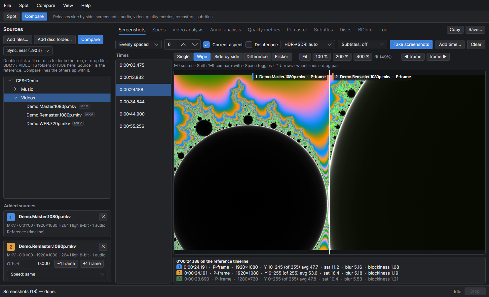
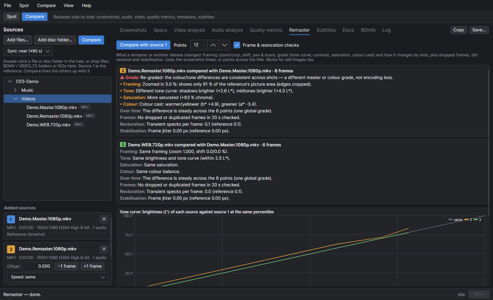
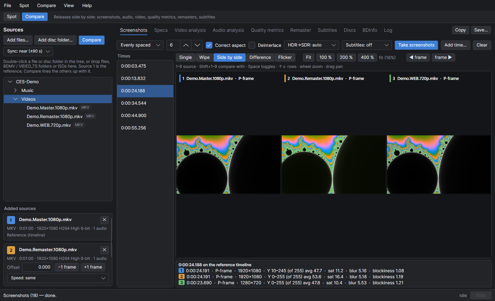
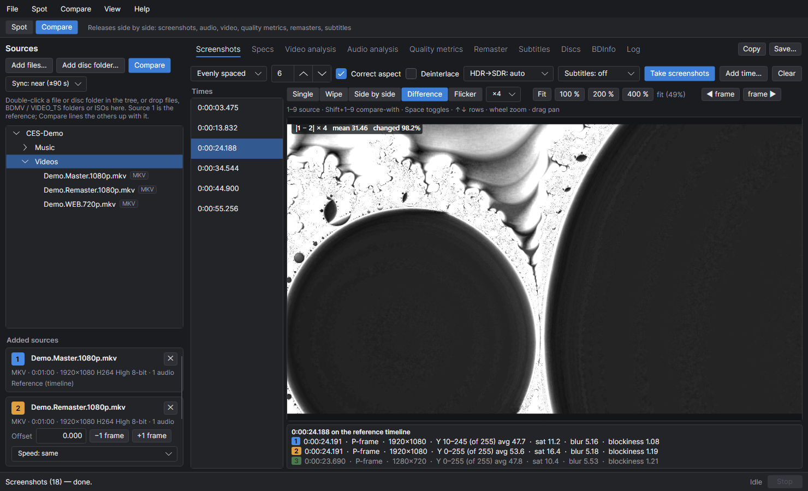
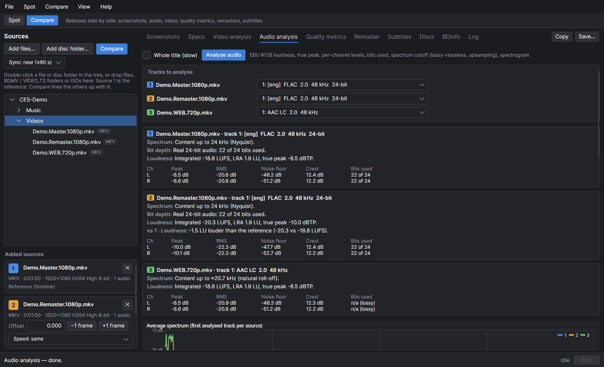

# NothingElseCompares2u

*(…but a frame-exact screenshot does.)*

A dark, cross-platform (Avalonia / .NET 10) comparison tool for Blu-ray, DVD and video files, with a matching
command line, `nec2u`.



<sub>All screenshots are made from synthetic test sources (an ffmpeg mandelbrot zoom with generated audio): a master, a
re-graded and reframed "remaster", and a 720p WEB encode.</sub>

## What it does

- **Sources**: MKV, MP4, M2TS/TS, VOB and other ffmpeg-readable files; Blu-ray folders (BDMV) and DVD folders
  (VIDEO_TS), read through their own playlists/IFOs (titles, segments, chapters, stream languages, angles); ISO images,
  mounted read-only with the OS (Windows `Mount-DiskImage`, Linux `udisksctl`, macOS `hdiutil`). Unencrypted discs only.
- **Frame-exact screenshots** of the same moment in every source: evenly spaced, random (seeded), per chapter or at given
  times; aspect correction for anamorphic video, HDR→SDR tone-mapping, optional deinterlace. The reference frame decides
  the time and every other source is aimed at its nearest matching frame, so MPEG-TS seek overshoot and frame-grid
  phase cannot shift a source by one frame. Viewer: single (1–9 to switch), wipe, side by side, **difference**
  (|A − B| × gain, with mean/changed share) and **flicker** (A ↔ B automatically); synced zoom/pan with
  nearest-neighbour pixels; frame stepping; frame type and signal stats per shot. **Detailed shots** mode samples
  keyframes across source 1 and picks well-lit, detailed moments instead of evenly spaced times.
- **Sync**: audio cross-correlation at several points, then refined on the picture to the exact frame. Search near the
  same time (±90 s) or the **whole title** (any offset). **Speed**: PAL speed-ups (23.976/24 → 25) are detected from the
  frame rates and handled everywhere (frames paired one to one). **Different edits**: probes along the whole title build
  sections with their own offset and mark parts that are missing from a source; each cut is then placed on the exact
frame by matching the pictures around it. **Telecine**: a 29.97 fps 3:2 pulldown source paired with 23.976 fps film
is detected and inverse-telecined (field matching + decimation) so frames pair one to one.
- **Comparisons are saved** as `.nec2u` files (sources, titles, time maps, screenshot times, analysis, metrics, ranking,
  grade and frame checks);
  screenshots are re-grabbed on open. Recent comparisons in the File menu.
- **Specs**: side-by-side table (container, bitrates, codec/profile, resolution, DAR/SAR, bit depth, chroma, colour,
  HDR10/HDR10+/Dolby Vision, mastering display, MaxCLL/FALL, audio tracks, subtitles…), differences highlighted.
- **Video analysis**: effective bit depth (8-bit padded into 10-bit), native resolution / upscale detection (least-squares
  descale at many heights and six kernels, harmonic-aware), detail spectrum and sharpness, black bars, limited-range
  violations, measured HDR brightness (fake/flat HDR), interlacing.
- **Audio analysis**: EBU R128 loudness, LRA, true peak, per-channel peak/RMS/noise floor/crest, bits really used
  (padded 16-bit in 24-bit), spectrum cutoff (lossy source in a lossless track, upsampled 44.1/48 kHz), silent channels,
  spectrogram.
- **Quality metrics**: PSNR, SSIM, VMAF, XPSNR against a reference, with automatic scaling and crop of bars, per-frame
  chart, worst frames → screenshots. The first frames of both sources are checked against each other so a one-frame
  slip cannot spoil the scores.

  
- **Remasters**: on matched frames, the zoom/crop and shift between releases (open matte vs cropped, reframing,
  pan & scan) and the grade in CIELAB: tone curve (shadows/mids/highlights), contrast, saturation, colour cast — with a
  "re-graded" verdict. **Grade over time** charts the difference per point and tells one global grade from a
  shot-by-shot regrade. **Frame & restoration checks**: dropped or duplicated frames against the reference, dirt and
  specks removed (or added) by a restoration, and stabilisation (gate weave / shake removed). Works on still images too.

  
- **Artefacts vs the reference**: grain removed (noise reduction), sharpening halos, more banding, softer picture; chroma upsampled
  from 4:2:0 (clean masters). **Audio vs the reference**: louder, brick-walled (crest/LRA), different EQ/master, and
  upmixed "fake" 5.1 (surrounds = copies or L−R, centre = L+R).
- **HDR**: HDR10+ / Dolby Vision per-shot metadata checked against the measured picture; wrong MaxCLL; DV profile 5 note.
- **Subtitles**: burn PGS / VobSub / text subtitles into screenshots (same language in every source); compare subtitle
  timing between releases (shift, spread, drift per hour, missing lines) — Blu-ray, DVD and file tracks.
- **Still images** (PNG/JPEG/TIFF/BMP/WebP) as sources: viewer, analysis and grade comparison work on pictures.
- **Share**: upload the screenshots to slow.pics (asks first; unlisted by default) and copy a BBCode/Markdown summary.
- **Fast**: screenshot cache (reopened comparisons and retakes are instant), parallel grabs; optional hardware decoding.
- **Rank releases**: point it at a folder of releases (File › Add folder of releases); every release is synced and
  measured against the reference in several windows across the title, then ranked (VMAF, 1 % low, PSNR, SSIM, bitrate).
- **HTML report**: specs, findings, metrics charts and click/1–9 switchable screenshots.

## More screenshots

| | |
|---|---|
|  |  |
|  |  |
|  | |

## Requirements

ffmpeg + ffprobe (with libvmaf for VMAF; zscale for HDR tone-mapping), optionally MediaInfo CLI. Found next to the program
(`ffmpeg\`, `mediainfo\`), via Settings, or on PATH.

## Command line

```
nec2u info   <source…> [--titles]
nec2u sync   <reference> <other…> [--whole] [--edits]
nec2u shots  <source…> [-n 6 | --at 1:02:03,… | --random | --chapters | --smart] [--subs eng] [--auto-sync] [--out DIR] [--slowpics] [--summary bbcode]
nec2u video  <source…> [--points 8] [--curve]
nec2u audio  <source…> [--track 1|all] [--full] [--out DIR]
nec2u metrics <reference> <other…> [--metrics psnr,ssim,vmaf,xpsnr] [--start T] [--length 60]
nec2u grade  <reference> <other…> [-n 8 | --at T,…] [--windows 5] [--no-temporal] [--curve]
                                                          (remaster: framing, grade, grade over time, frame checks)
nec2u subs   <reference> <other…> [--subs eng]           (subtitle timing)
nec2u rank   <reference> <release… | folder> [--windows 5] [--length 20] [--edits]
nec2u report <source…> [--metrics] [--out DIR]
```

Pick a disc title with `path@00800.mpls` or `path@3`; offsets with `--offset 2=-5.005`, speed with `--speed 2=pal`. See `nec2u --help`.

## Build

```
dotnet build NothingElseCompares2u.sln
dotnet test
```
