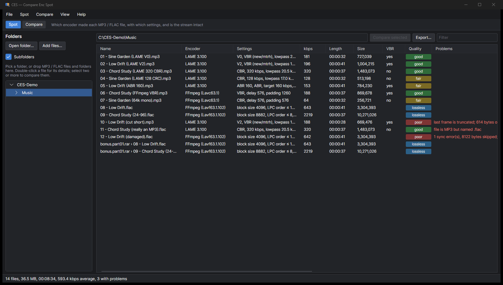
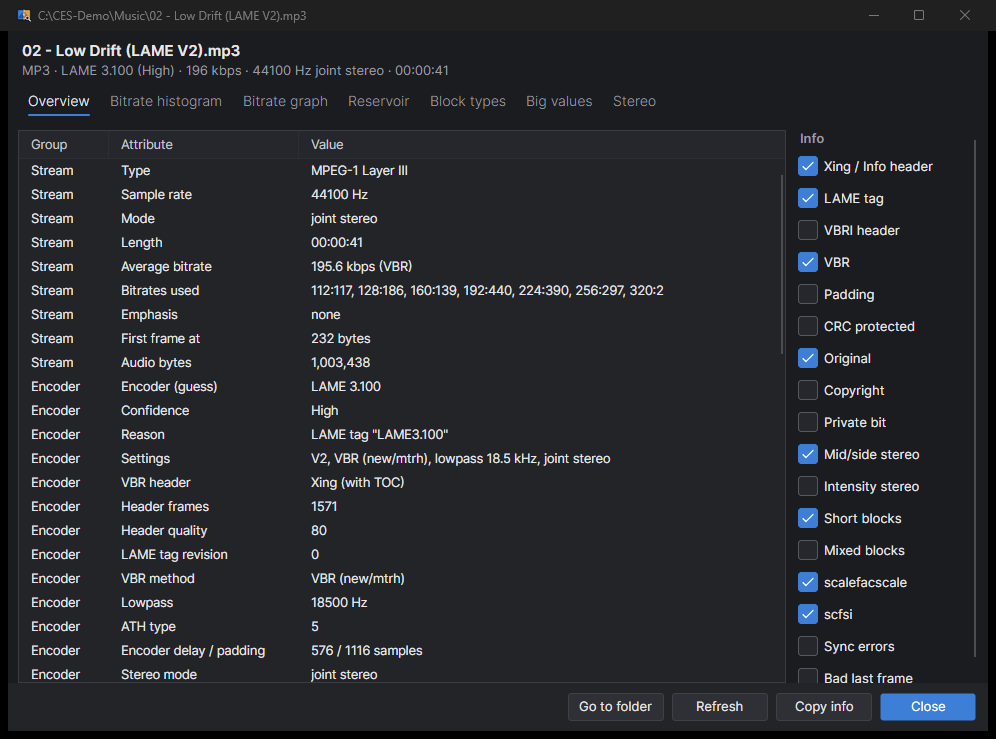
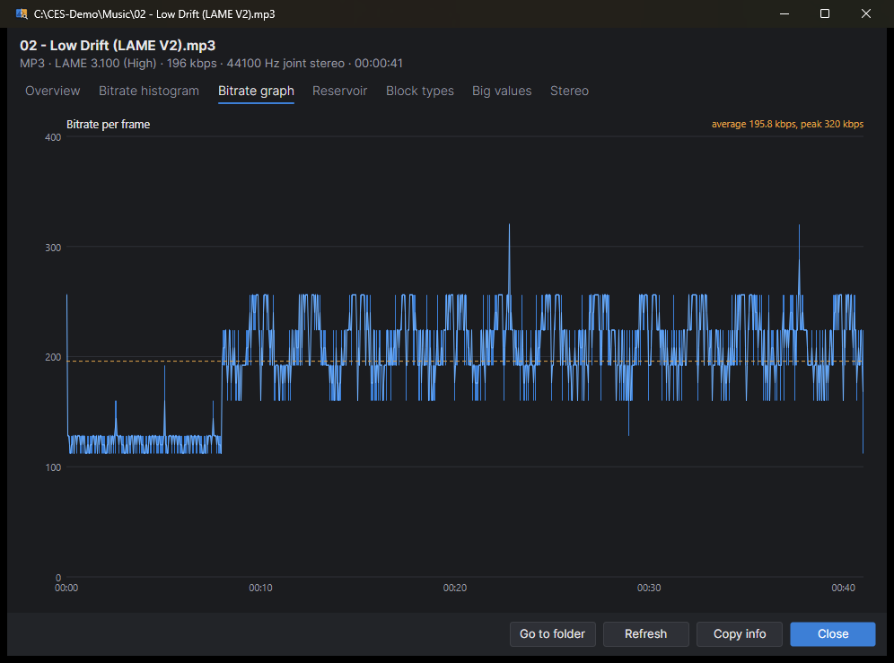
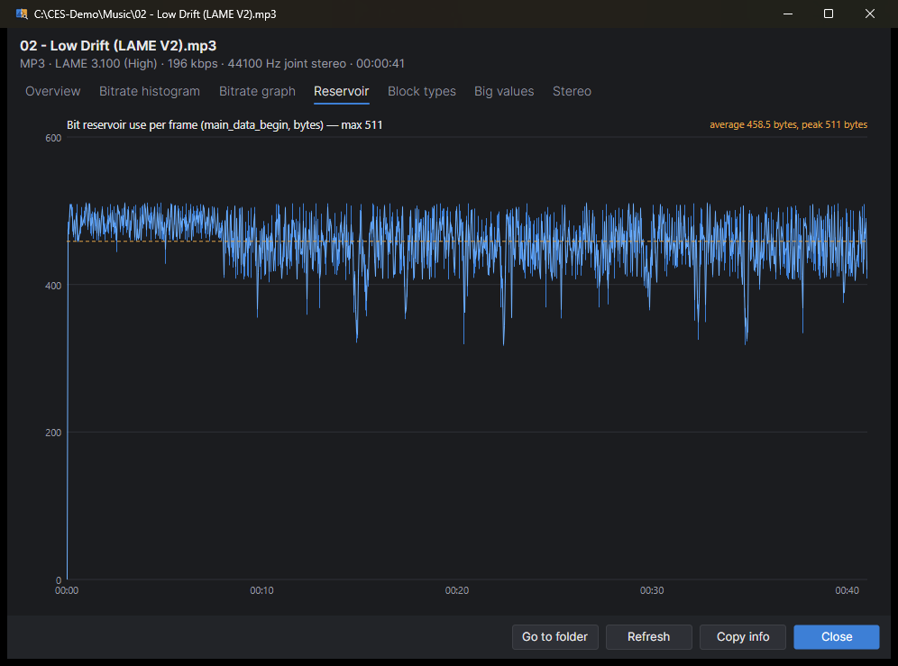
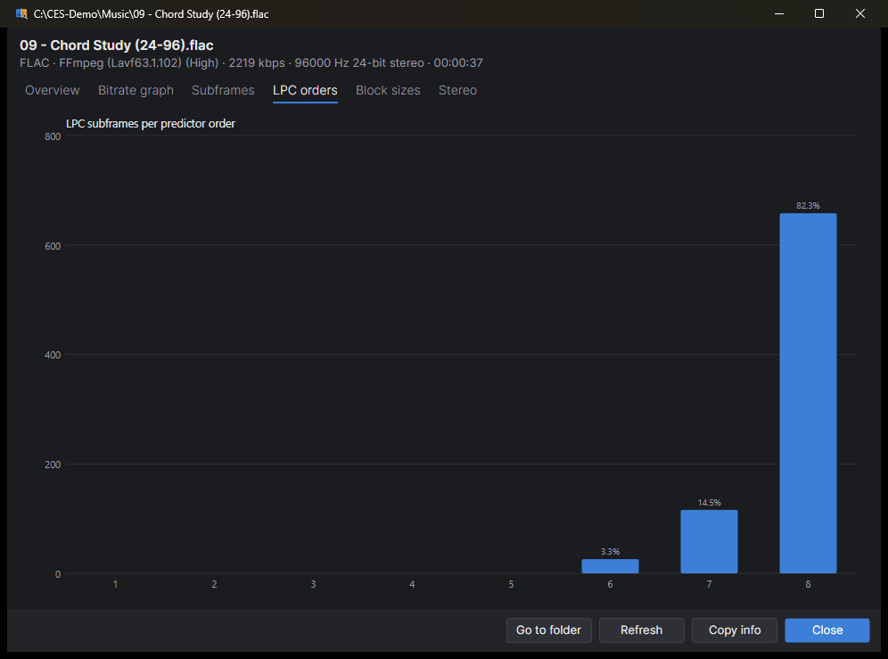
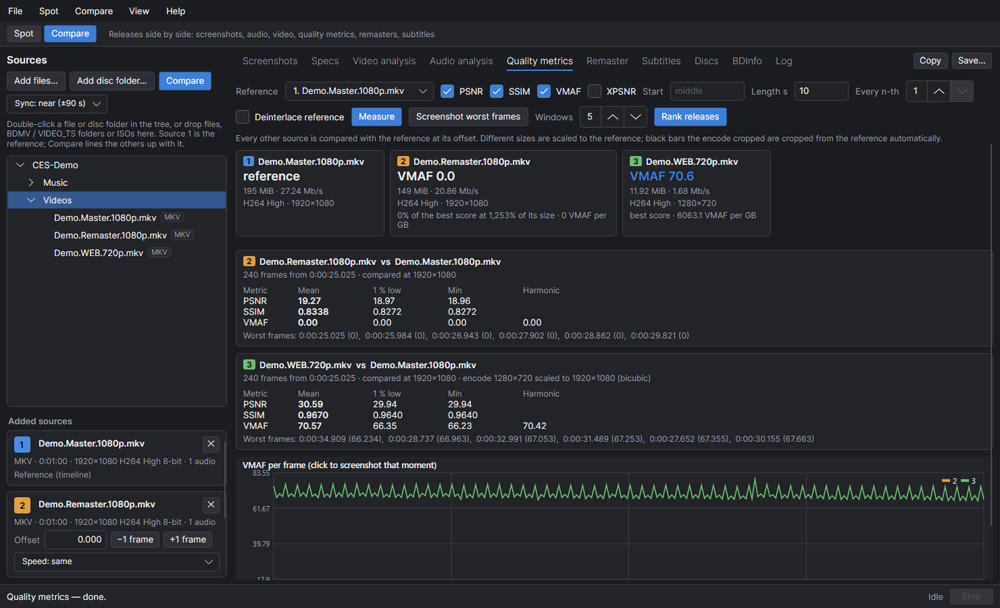
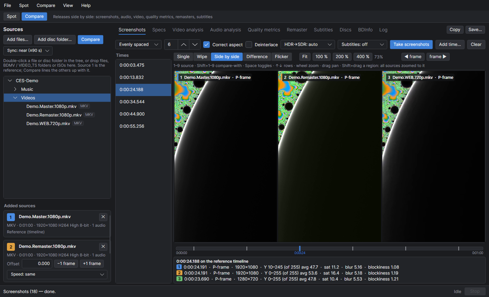
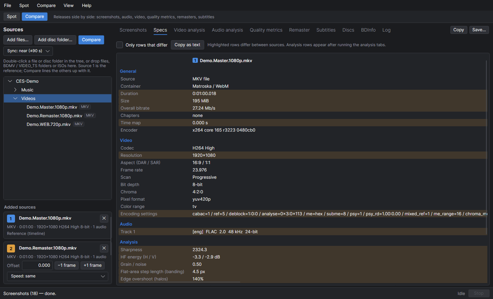
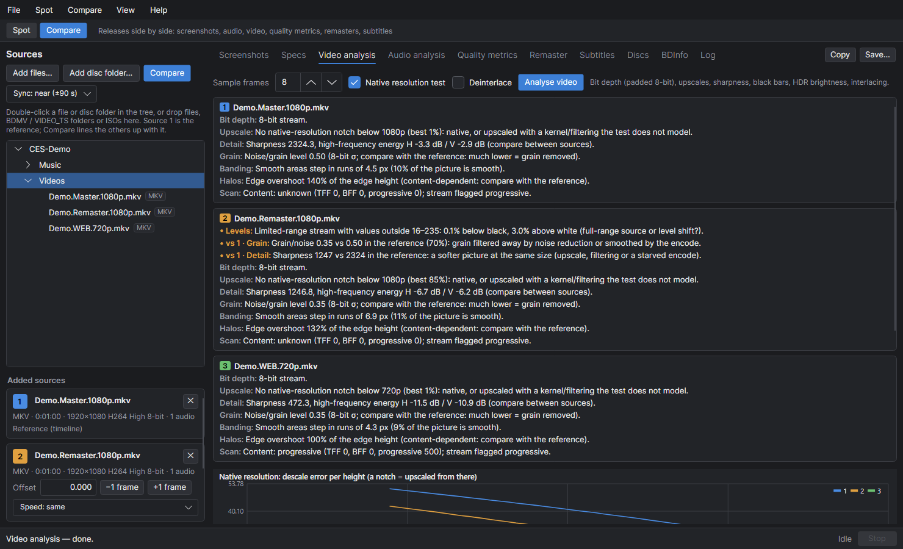

# CES — Compare Enc Spot

A dark, cross-platform (Avalonia / .NET 10) tool with two modes and one command line, `ces`:

- **Spot** — point it at a folder of MP3 or FLAC files and it tells you which encoder made each one, with which
  settings, and whether the stream is intact (a modern take on EncSpot).
- **Compare** — Blu-ray, DVD and video releases side by side: frame-exact screenshots, sync, audio, video, quality
  metrics, remasters and subtitles.

Both modes share one window, menu and status bar; switch with the Spot / Compare buttons or Ctrl+1 / Ctrl+2. In Spot,
select two or more files and choose **Compare selected** to open them in Compare. The bottom right of the status bar
always shows what is running (job, count, elapsed time, progress) with a **Stop** button.

**Results cache**: analysis results are kept for files seen before (same path, size and modification time), so
revisiting a folder in Spot, or adding the same release again in Compare, brings back its results instantly: Spot file
analyses; Compare video/audio analysis, sync, remaster checks, quality metrics and BDInfo full scans. Size limit and
*Clear cache* in File › Settings (0 turns it off). **Save results** (Ctrl+S) saves the current mode's results:
Spot results as `.cess`, comparisons as `.cesc`; **Open saved results** (Ctrl+L) opens either.

Both modes navigate the same way: a directory tree on the left (opening where you last were), buttons above it
(Spot: *Open folder*, *Add files*; Compare: *Add files*, *Add disc folder*, **Compare**), and the results on the right.
In Compare the tree also lists media files and tags Blu-ray (BD) and DVD folders; double-click one to add it as a
source. **Compare** lines the sources up with source 1 (audio match, refined to the exact frame).

## RAR sets and disc images

Both modes read **inside RAR sets and ISO images without unpacking or mounting**:

- RAR 4 and RAR 5, multi-volume (`.rar` + `.r00…`, or `.part1.rar…`): stored (`-m0`) files — as most release groups use —
  are read in place. Compressed or password-protected sets are reported, not misread.
- ISO images are read with CES's own UDF reader (DVD-Video UDF 1.02 and Blu-ray UDF 2.50 with its metadata partition),
  so a **Blu-ray or DVD ISO inside a RAR set** opens directly, on Windows, Linux and macOS alike.
- Open a `.rar`, an `.iso` or a release folder: CES picks the disc structure, ISO or main video inside
  (samples skipped). Spot lists the MP3 / FLAC inside RAR sets.
- ffmpeg, ffprobe and MediaInfo read these files through a small built-in HTTP server on 127.0.0.1 (byte ranges,
  so seeking works); nothing is extracted to disk.
- `ces ls <set.rar | image.iso | set.rar::inner.iso>` lists what is inside. Inner paths use `::`, e.g.
  `ces spot "music.rar::01-track.flac"`.

## Spot mode



| | |
|---|---|
|  |  |
|  |  |

<sub>Made from synthetic test tones encoded with stock LAME 3.100 and FFmpeg, plus a truncated MP3, an MP3 named
.flac, a damaged FLAC and a RAR set with FLACs inside.</sub>

**MP3 / MP2 / MP1**: every frame header, Layer III side info (block types, scalefac_scale, scfsi, preflag, big_values),
the bit reservoir and ancillary data, Xing/Info + LAME tag (preset, VBR method, lowpass, delay/padding, ReplayGain,
**tag CRC and music CRC check**), VBRI (FhG), frame CRCs, ID3v1/ID3v2/APE/Lyrics3 tags. It reports sync errors,
truncated last frames, junk after the audio, and files whose content does not match their extension.

**FLAC**: all metadata blocks and the vendor string, plus a full decode of every frame: CRC-8/CRC-16 checks,
**MD5 verification**, subframe types, LPC orders and precision, Rice partitions and stereo decorrelation. From these it
estimates the libFLAC compression level, and it recognises FFmpeg-encoded FLAC from the frame layout when a tagger
(e.g. Mutagen) has replaced the vendor string. Spot mode needs no ffmpeg for audio.

**Is the lossless file really lossless?** FLAC and WAV are decoded and their spectrum checked: a brick-wall lowpass
well below Nyquist means a lossy source (MP3/AAC, with a hint at the likely bitrate), a cliff at 22.05/24 kHz in a
88.2/96/192 kHz file means it was upsampled, and zero low bits in every sample mean 16-bit audio padded to 24 bits.
The verdict is in the **Source** column, the evidence in the details window's **Spectrum** tab.

**More formats**: **WAV** (PCM/float, LIST/INFO and BWF tags), **Ogg Vorbis / Opus / FLAC** (every page CRC
checked, encoder from the vendor string — libVorbis version, aoTuV, libopus, FFmpeg), **M4A** AAC (profile incl.
HE-AAC, declared bitrates) and ALAC, with iTunes / qaac / FAAC / FFmpeg encoder tags.

**Video at a glance** (needs ffmpeg): MKV, MP4, M2TS, AVI, ISOs and Blu-ray / DVD folders (one row per disc, also
inside RAR sets) show codec, resolution, frame rate, HDR, bitrate, the encoder library and its key x264/x265
settings (CRF or 2-pass bitrate, ref, bframes, aq, psy-rd) and the audio / subtitle tracks; the details window has
the full spec list. Spot › Include video files turns it off.

Right-click a column header (or Spot › Columns) to choose columns; widths, order and the sort are remembered.

The file list has an EncSpot-style quality column; double-click a file for its details: bitrate histogram and graph,
reservoir use, block types, big values, stereo modes, FLAC predictor and LPC-order charts. **Save…** in the details
window (or *Save details…* on selected files) writes the details as text or as JSON with everything that was measured;
saved Spot results (`.cess`) reopen the whole list without reading the files again.

```
ces spot [-r] [-d] [-j] [-q] [-p] [-t N] <file or folder>…
  -r recursive   -d details   -j JSON   -q FLAC metadata only   -p only problems
exit code 0 = ok, 1 = some files have problems
```

## Compare mode


<sub>All screenshots are made from synthetic test sources (an ffmpeg mandelbrot zoom with generated audio): a master, a
re-graded and reframed "remaster", and a 720p WEB encode.</sub>

- **Sources**: MKV, MP4, M2TS/TS, VOB and other ffmpeg-readable files; Blu-ray folders (BDMV) and DVD folders
  (VIDEO_TS), read through their own playlists/IFOs (titles, segments, chapters, stream languages, angles); ISO images,
  mounted read-only with the OS (Windows `Mount-DiskImage`, Linux `udisksctl`, macOS `hdiutil`). Unencrypted discs only.
- **Compare all** (Ctrl+Shift+A): line up, screenshots, video and audio analysis, quality metrics, remaster and subtitle
  checks in one run. It first lists the steps with a rough time for each (from duration, resolution and the options)
  and the total; steps whose results are already there start unticked. While it runs, an hourglass and "about n min
  left" sit next to the elapsed time, and Stop halts the current step and skips the rest. The estimates adapt to the machine
  after each run.
- **Frame-exact screenshots** of the same moment in every source: evenly spaced, random (seeded), per chapter or at given
  times; aspect correction for anamorphic video, HDR→SDR tone-mapping, optional deinterlace. The reference frame decides
  the time and every other source is aimed at its nearest matching frame, so MPEG-TS seek overshoot and frame-grid
  phase cannot shift a source by one frame. Viewer: single (1–9 to switch), wipe, side by side, **difference**
  (|A − B| × gain, with mean/changed share) and **flicker** (A ↔ B automatically); synced zoom/pan with
  nearest-neighbour pixels; **Shift+drag a region** to see it from every source side by side, zoomed to fill; a
  timeline strip with the screenshot times and chapters; frame stepping; frame type and signal stats per shot. **Detailed shots** mode samples
  keyframes across source 1 and picks well-lit, detailed moments instead of evenly spaced times.
- **Sync**: audio cross-correlation at several points, then refined on the picture to the exact frame. Search near the
  same time (±90 s) or the **whole title** (any offset). **Speed**: PAL speed-ups (23.976/24 → 25) are detected from the
  frame rates and handled everywhere (frames paired one to one). **Different edits**: probes along the whole title build
  sections with their own offset and mark parts that are missing from a source; each cut is then placed on the exact
frame by matching the pictures around it. **Telecine**: a 29.97 fps 3:2 pulldown source paired with 23.976 fps film
is detected and inverse-telecined (field matching + decimation) so frames pair one to one.
- **Comparisons are saved** as `.cesc` files (sources, titles, time maps, screenshot times, analysis, metrics, ranking,
  grade and frame checks);
  screenshots are re-grabbed on open. Recent comparisons in the File menu.
- **Copy / Save…** at the right of the tabs: what the open tab shows as text (specs, video/audio findings and channel
  stats, metrics and worst frames, remaster checks, subtitles, disc titles, BDInfo, screenshot stats); Ctrl+Shift+T.
- **BDInfo**: the Blu-ray report from the BDInfo engine for each disc source (folder, ISO, or ISO inside a RAR set):
  quick summaries side by side with differences highlighted, and the full BDInfo report (forum paste, streams,
  chapters, stream diagnostics). **Full scan** reads the compared titles completely for exact sizes and bitrates.
  Copy or save the reports; they are also in the HTML report.
- **Specs**: side-by-side table (container, bitrates, codec/profile, resolution, DAR/SAR, bit depth, chroma, colour,
  HDR10/HDR10+/Dolby Vision, mastering display, MaxCLL/FALL, audio tracks, subtitles…), differences highlighted.
- **Video analysis**: effective bit depth (8-bit padded into 10-bit), native resolution / upscale detection (least-squares
  descale at many heights and six kernels, harmonic-aware), detail spectrum and sharpness, black bars, limited-range
  violations, measured HDR brightness (fake/flat HDR), interlacing.
- **Audio analysis**: EBU R128 loudness, LRA, true peak, per-channel peak/RMS/noise floor/crest, bits really used
  (padded 16-bit in 24-bit), spectrum cutoff (lossy source in a lossless track, upsampled 44.1/48 kHz), silent channels,
  spectrogram.
- **Quality metrics**: PSNR, SSIM, VMAF, XPSNR against a reference, with automatic scaling and crop of bars, per-frame
  chart, worst frames → screenshots. The first frames of both sources are checked against each other so a one-frame
  slip cannot spoil the scores.

  
- **Remasters**: on matched frames, the zoom/crop and shift between releases (open matte vs cropped, reframing,
  pan & scan) and the grade in CIELAB: tone curve (shadows/mids/highlights), contrast, saturation, colour cast — with a
  "re-graded" verdict. **Grade over time** charts the difference per point and tells one global grade from a
  shot-by-shot regrade. **Frame & restoration checks**: dropped or duplicated frames against the reference, dirt and
  specks removed (or added) by a restoration, and stabilisation (gate weave / shake removed). Works on still images too.

  
- **Artefacts vs the reference**: grain removed (noise reduction), sharpening halos, more banding, softer picture; chroma upsampled
  from 4:2:0 (clean masters). **Audio vs the reference**: louder, brick-walled (crest/LRA), different EQ/master, and
  upmixed "fake" 5.1 (surrounds = copies or L−R, centre = L+R).
- **HDR**: HDR10+ / Dolby Vision per-shot metadata checked against the measured picture; wrong MaxCLL; DV profile 5 note.
- **Subtitles**: burn PGS / VobSub / text subtitles into screenshots (same language in every source); compare subtitle
  timing between releases (shift, spread, drift per hour, missing lines) — Blu-ray, DVD and file tracks.
- **Still images** (PNG/JPEG/TIFF/BMP/WebP) as sources: viewer, analysis and grade comparison work on pictures.
- **Share**: upload the screenshots to slow.pics (asks first; unlisted by default) and copy a BBCode/Markdown summary.
- **Fast**: screenshot cache (reopened comparisons and retakes are instant), parallel grabs; optional hardware decoding.
- **Rank releases**: point it at a folder of releases (File › Add folder of releases); every release is synced and
  measured against the reference in several windows across the title, then ranked (VMAF, 1 % low, PSNR, SSIM, bitrate).
- **Release cards** in the Quality tab: size, bitrate and picture of each release with its VMAF against source 1,
  and its value — "93 % of the best score at 40 % of its size" and VMAF points per GB.
- **HTML report**: specs, findings, metrics charts and click/1–9 switchable screenshots.

## More screenshots

| | |
|---|---|
|  |  |
|  | |
|  |  |
|  | |

## Requirements

ffmpeg + ffprobe (with libvmaf for VMAF; zscale for HDR tone-mapping), optionally MediaInfo CLI. Found next to the program
(`ffmpeg\`, `mediainfo\`), via Settings, or on PATH.

## Command line

```
ces info   <source…> [--titles]
ces sync   <reference> <other…> [--whole] [--edits]
ces shots  <source…> [-n 6 | --at 1:02:03,… | --random | --chapters | --smart] [--subs eng] [--auto-sync] [--out DIR] [--slowpics] [--summary bbcode]
ces video  <source…> [--points 8] [--curve]
ces audio  <source…> [--track 1|all] [--full] [--out DIR]
ces metrics <reference> <other…> [--metrics psnr,ssim,vmaf,xpsnr] [--start T] [--length 60]
ces grade  <reference> <other…> [-n 8 | --at T,…] [--windows 5] [--no-temporal] [--curve]
                                                          (remaster: framing, grade, grade over time, frame checks)
ces subs   <reference> <other…> [--subs eng]           (subtitle timing)
ces rank   <reference> <release… | folder> [--windows 5] [--length 20] [--edits]
ces report <source…> [--metrics] [--out DIR] [--bdinfo-scan | --no-bdinfo]
ces bdinfo <Blu-ray folder | ISO | RAR set> [-p 00800] [-a] [-q] [-l] [-o FILE]   (BDInfo report; no ffmpeg needed)
```

Pick a disc title with `path@00800.mpls` or `path@3`; offsets with `--offset 2=-5.005`, speed with `--speed 2=pal`. See `ces --help`.

## Install on Debian / Ubuntu

```
sudo apt install ./ces_0.3.3_debian13_amd64.deb        # Debian 13
sudo apt install ./ces_0.3.3_ubuntu24.04_amd64.deb     # Ubuntu 24.04
```

Installs to `/opt/ces` with the commands `ces` (command line) and `ces-gui`, plus a menu entry.
**Compare mode needs ffmpeg**: `sudo apt install ffmpeg mediainfo` (apt installs them along with CES unless
recommended packages are turned off). Spot mode and `ces bdinfo` do not need ffmpeg. Packages are built with
`pwsh packaging/build-linux.ps1` (add `-Test` to install, run and purge each one in its WSL distro).

## Build

```
dotnet build CES.sln
dotnet test
```
